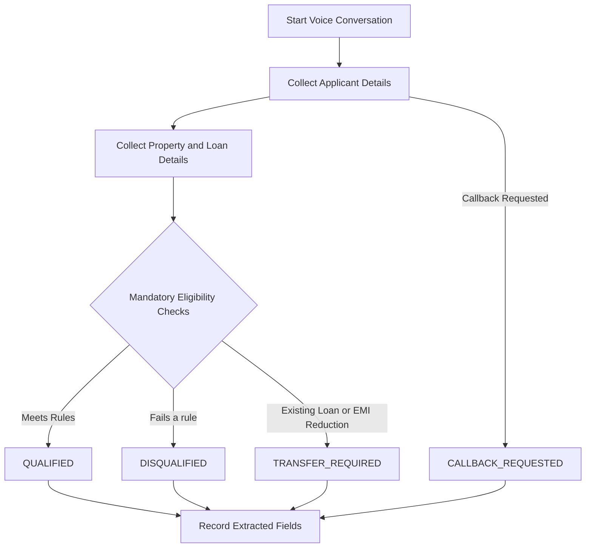

# Home Credit LAP Qualification Voice Agent

An AI-powered voice agent built with **Retell AI** to conduct preliminary Loan Against Property (LAP) eligibility screening through natural conversations.

The agent gathers applicant and property details, applies predefined business rules, and identifies whether an applicant is preliminarily qualified, disqualified, requires specialist assistance, or requests a callback.

## Project Overview

**Objective:** Automate the initial screening stage of a Loan Against Property application using a conversational voice interface.

**Key capabilities**
- Voice-based collection of applicant and property information.
- Property type, ownership, and document verification.
- Loan amount and tenure validation.
- Occupation and income mode checks.
- Specialist transfer handling for existing property loans or EMI reduction requests.
- Structured qualification outcomes and post-call data extraction.
- Scenario-based testing with recorded conversations and reports.

## Qualification Workflow



## Business Rules

| Criterion | Rule |
|---|---|
| Maximum loan amount | ₹75,00,000 |
| Eligible property types | Residential, commercial, industrial |
| Agricultural property | Not eligible |
| Ownership | Sole or joint |
| Original property documents | Must be available |
| Occupation | Salaried or self-employed |
| Income mode | Bank income accepted; cash income disqualifies |
| Loan tenure | 3–15 years, inclusive |

### Loan Amount Handling

When an applicant requests more than ₹75,00,000, the agent explains the maximum available amount and asks whether the applicant wishes to proceed with the limit. If accepted, the qualification amount is capped at ₹75,00,000; if refused, the applicant is disqualified.

### Specialist Escalation

Requests involving an existing loan against the property or a desire to reduce EMI are referred to a specialist, provided a disqualification condition has not already been triggered.

## Qualification Outcomes

| Status | Meaning |
|---|---|
| `QUALIFIED` | Meets the configured preliminary eligibility rules |
| `DISQUALIFIED` | Fails a mandatory eligibility condition |
| `TRANSFER_REQUIRED` | Requires specialist assistance |
| `CALLBACK_REQUESTED` | Requests a callback |

## Data Extraction

The agent is designed to capture the following post-call fields:

- `qualification_status`
- `property_type`
- `ownership_status`
- `documents_available`
- `requested_loan_amount`
- `final_qualification_amount`
- `occupation`
- `income_mode`
- `market_value`
- `tenure_years`

Extracted values should reflect the conversation accurately. Unknown or unprovided details should not be invented.

## Testing and Validation

The repository contains 15 voice-call test scenarios, with associated recordings, transcripts, call logs, and test result reports.

The test scenarios cover:
- Successful preliminary qualification.
- Ineligible property types.
- Missing original property documents.
- Cash-based income.
- Loan amount and tenure conditions.
- Specialist escalation scenarios.
- Callback requests.

Test reports document the observed qualification outcomes. Refer to the individual reports in `04_Test_Results/` for scenario-level evidence.

## Technology Stack

- **Retell AI** — Voice-agent configuration and conversational interaction.
- **Prompt engineering** — Qualification logic, conversation flow, and response behavior.
- **Structured testing** — Scenario-based validation using recordings, transcripts, call logs, and reports.
- **Git and GitHub** — Version control and project documentation.

## Repository Structure

```text
Home-Credit-LAP-Voice-Agent/
├── 01_System_Prompt/
│   └── final_system_prompt.txt
├── 02_Voice_Agent/
│   └── agent_details.txt
├── 03_Call_Recordings/
│   ├── Recordings
│   ├── Transcripts
│   └── Call Logs
├── 04_Test_Results/
│   └── Test Result Reports
├── 05_Design_Notes/
│   └── design_notes.md.txt
├── business_rules.md.txt
├── conversation_states.md.txt
├── prompt_review.md.txt
└── test_cases.md.txt
```

## Limitations and Responsible Use

- This agent performs preliminary screening; it does not guarantee loan approval.
- Final approval, interest rates, and loan terms must be confirmed by the lender's authorized specialist.
- Callback requests should not be treated as confirmed bookings unless a scheduling system confirms them.
- Eligibility decisions depend on the configured rules and the accuracy of the information provided by the applicant.

## Future Improvements

- Integrate a backend to persist qualification results.
- Add automated validation of extracted fields against expected test outcomes.
- Integrate a real callback scheduling mechanism.
- Expand testing for ambiguous answers, interruptions, and incomplete conversations.
- Add automated regression testing when the system prompt changes.

## Project Summary

This project demonstrates the application of conversational AI, prompt engineering, business-rule validation, structured data extraction, and scenario-based testing to a financial-services qualification workflow.
